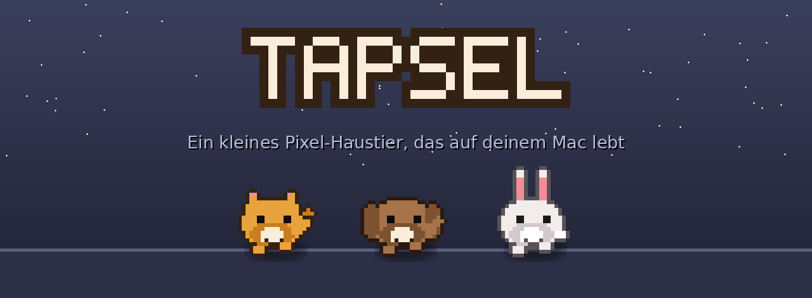
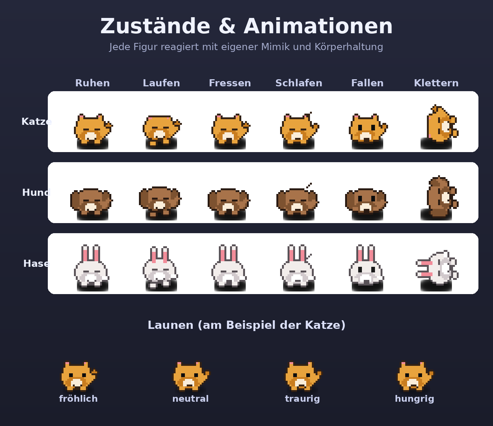
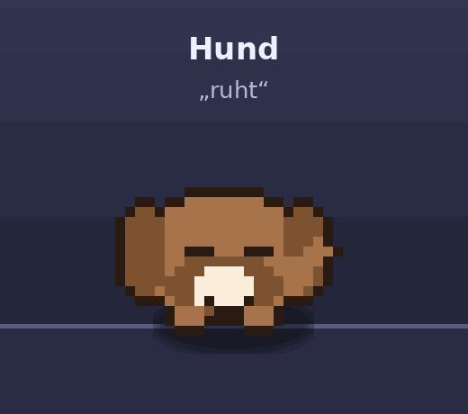
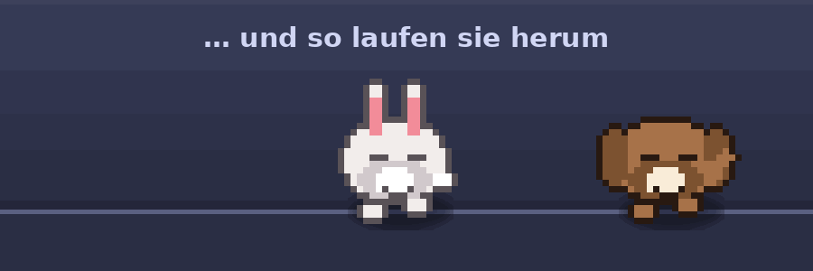

<p align="center">
  
</p>

<p align="center">
  Ein kleines Pixel-Haustier, das wirklich auf deinem Mac-Desktop lebt.
</p>

Tapsel läuft am unteren Bildschirmrand herum, klettert auf deine echten
Fenster, hat Hunger/Laune/Energie — und du kannst es füttern, streicheln und
mit dir ziehen. Gebaut als native macOS-App (Swift + AppKit, **kein
Electron**): ~45 MB RAM, ~1,5–2 % CPU, kein Dock-Icon, läuft nur als kleiner
Menüleisten-Helfer.

## Was Tapsel kann

🐾 **Drei Haustiere** — Katze, Hund, Hase, jederzeit wechselbar.

<p align="center">
  
</p>

Je nach Hunger/Laune/Energie verhält es sich anders — fröhlich, neutral,
traurig, hungrig oder müde, und es schläft, wenn es erschöpft ist.

🪟 **Klettert auf deinen echten Fenstern** — nicht nur auf dem Desktop:

<p align="center">
  
</p>

- setzt sich auf Fenster-Oberkanten und läuft darauf herum
- springt auf Fenster, die in Reichweite sind
- klettert an Bildschirmrändern hoch und steigt oben auf eine Kante über
- fällt mit echter Schwerkraft, wenn das Fenster verschwindet oder du es
  fallen lässt
- fährt flüssig mit, wenn du das Fenster verschiebst, auf dem es sitzt

<p align="center">
  
</p>

🍖 **Füttern & streicheln** — anklicken, übers Menü, oder per Tastenkürzel
(Standard `⌘F` / `⌘S`, systemweit, auch ohne geöffnetes Menü). Hunger, Laune
und Energie verändern sich mit der Zeit, auch während die App geschlossen
ist — beim nächsten Start wird einfach nachgerechnet, was in der
Zwischenzeit passiert wäre.

🖱️ **Greifbar** — mit der Maus packen und woanders hinziehen. Klicks gehen
sonst überall durch Tapsel hindurch zu den Fenstern dahinter.

⚙️ **Echtes Einstellungsfenster** statt nur Menü (`⌘,`):

- Haustier wechseln — mit einer Vorschau der echten Pixel-Sprites, kein
  reines Text-Menü
- Tastenkürzel für Füttern/Streicheln frei belegbar (klicken, Tastenkombi
  drücken)
- Lauf-Tempo per Schieberegler
- Startbildschirm bei Multi-Monitor-Setups
- „Bei der Anmeldung starten“

## Installation

**Fertige App bauen & starten:**

```bash
Scripts/build_app.sh --dmg
```

Erzeugt `dist/Tapsel.app` (direkt per Doppelklick startbar oder in den
`Applications`-Ordner ziehen) und `dist/Tapsel.dmg` zum Weitergeben. Beim
ersten Start ggf. Rechtsklick → „Öffnen“, da die App nur ad-hoc signiert ist
(macOS Gatekeeper fragt sonst nach, weil sie nicht notarisiert ist).

**Oder direkt aus dem Quellcode starten** (Xcode/Swift-Compiler nötig):

```bash
swift run
```

## Zu den Berechtigungen

Tapsel braucht **keine** Sonderberechtigungen. Für das Klettern auf Fenstern
liest die App nur deren Geometrie (Position/Größe) — nie Fenstertitel oder
-inhalte, das würde Bildschirmaufnahme-Rechte erfordern. Die systemweiten
Tastenkürzel laufen über eine klassische macOS-Hotkey-Registrierung statt
über einen Tastatur-Monitor, auch das braucht keine Freigabe.

## Bekannte Einschränkungen

- Nur ein Pet gleichzeitig sichtbar (Wechsel ersetzt die Figur, Hunger/Laune
  bleiben aber erhalten).
- Multi-Monitor funktioniert grundsätzlich, ist aber kaum getestet.
- App ist nur ad-hoc signiert, nicht notarisiert.

## Ideen für später

- Mehr Animationen/Reaktionen (z. B. Sprechblase beim Füttern), weitere Tiere.
- Verschiedene Futter-Arten per Drag & Drop.
- Sound-Effekte.
- Auto-Update-Mechanismus, falls die App außerhalb des eigenen Rechners
  verteilt wird.

---

<details>
<summary><strong>Für Entwickler:innen</strong> — Projektstruktur & Dev-Flags</summary>

```
Sources/Tapsel/
  main.swift                     App-Einstieg (+ Dev-Flags, siehe unten)
  AppDelegate.swift               Verdrahtet Fenster + Menüleiste
  PetWindowController.swift       Erzeugt das transparente Overlay-Fenster
  PetView.swift                   Zeichnet das Pixel-Sprite, Drag & Rechtsklick-Menü
  PetMenuBuilder.swift            Gemeinsames Menü für Menüleiste + Rechtsklick
  PetEngine.swift                 "Gehirn": Timer, Physik, Zustandsmaschine
  WindowScanner.swift             Findet Fensterkanten (inkl. Verdeckungs-Prüfung)
  PetState.swift                  Hunger/Laune/Energie + Speichern/Laden
  BehaviorState.swift             idle/walk/eating/sleeping + Laune-Level
  PetKind.swift                   Katze/Hund/Hase + Farbpaletten
  SpriteBuilder.swift              Zeichnet ein Pixel-Frame aus Formen (Ellipsen etc.)
  PixelCanvas.swift                Kleines Pixel-Grid + Zeichen-Hilfsfunktionen
  StatusBarController.swift        Menüleisten-Symbol + Menü
  IconExporter.swift               Rendert das App-Icon aus dem Katzen-Sprite
  SettingsStore.swift              Persistierte Einstellungen (Shortcuts, Tempo, …)
  SettingsWindowController.swift   Das Einstellungsfenster
  PetThumbnailControl.swift        Anklickbare Pixel-Sprite-Vorschau im Einstellungsfenster
  ShortcutRecorderControl.swift    "Klick + Taste drücken"-Steuerelement
  KeyboardShortcut.swift           Modell für ein Tastenkürzel (Codable)
  GlobalHotKeyManager.swift        Systemweite Hotkeys (Carbon, keine Berechtigung nötig)
```

Nützliche Dev-Flags von `main.swift`:

```bash
# Sprite als ASCII-Grid ausgeben (schnelles Debuggen ohne Bild)
.build/debug/Tapsel --print-ascii cat

# Ein Pixel-Frame als PNG exportieren, z.B. zum Anschauen
.build/debug/Tapsel --export-icon /tmp/preview.png dog happy

# Menü-Struktur als Text ausgeben (prüfen ohne Screenshot)
.build/debug/Tapsel --dump-menu

# Physik live mitschreiben: Position, Zustand, gefundene Fensterkanten
# (optional: Start-X-Position, z.B. nah am linken Rand)
.build/debug/Tapsel --trace 30 100
```

</details>
